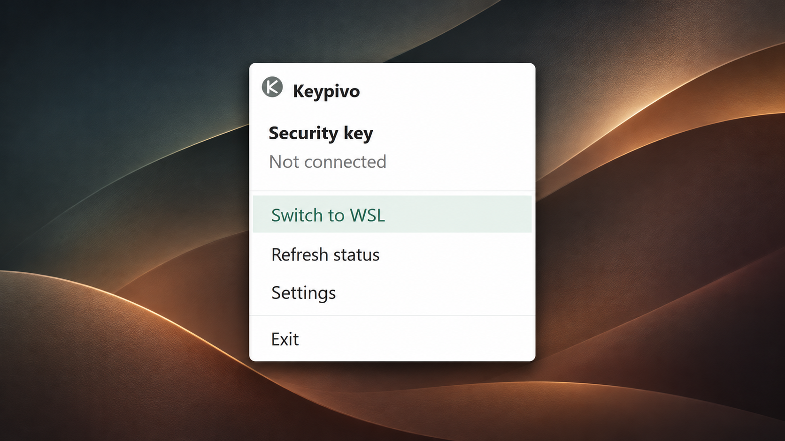

# Keypivo

Switch a USB security key between Windows and WSL2 from your system tray.

Get Keypivo from the [Microsoft Store](https://apps.microsoft.com/detail/9P9S5NCN2DQ4).



## Getting started

You need Windows 10 or 11, [usbipd-win](https://github.com/dorssel/usbipd-win) 5.x, and an installed WSL2 distribution.

Install usbipd-win:

```powershell
winget install --interactive --exact dorssel.usbipd-win
```

## Usage

1. Connect your security key and open a WSL2 terminal.
2. Click the Keypivo tray icon.
3. Choose **Switch to WSL** or **Switch to Windows**.

The menu updates the connection status automatically, and notifications let you know when it changes.

The menu shows the key's description, product, and persisted GUID. Use the information icon in the header to show all device details. Click a device value to copy it.

Click outside the menu or press Escape to dismiss it. Setup pages stay open while you work in PowerShell. **Exit** closes Keypivo and leaves the key's connection unchanged.

The key can be used by one operating system at a time. While connected to WSL2, it is unavailable to Windows apps.

For an unshared key, choose **Set up for WSL…**, copy the command, and run it in PowerShell as administrator. Keypivo detects when setup is complete. Select **Done** to return to the menu. Keypivo then handles everyday switching without administrator prompts.

Returning to Windows keeps the key shared. To remove sharing, first switch to Windows, then choose **Stop sharing this key** in Settings and follow the manual instructions.

## Settings

| Setting | Default | Description |
| --- | --- | --- |
| Vendor ID (VID) | `1050` | Four hexadecimal digits identifying the device vendor. |
| Product ID (PID) | Empty | Optional four-digit hexadecimal ID. Leave empty to match any product from the selected vendor. |
| Display position | Bottom right | Show the menu and Settings at the bottom right or center of the primary display. |
| Start at sign-in | On | Start Keypivo in the tray when you sign in to Windows, after the app has been opened once. |
| Notifications | All on | Choose which Windows notifications to receive under **At launch**, **Connection**, and **Attention**. |

If several connected devices match, Keypivo selects the first one. Changing the IDs does not disconnect a key that is already attached.

To turn off automatic startup, uncheck **Start at sign-in** and select **Save**. If Windows has disabled startup, use **Open Windows startup settings** to enable it again.

Turn off **Show notifications** to mute all notifications while keeping your individual choices. Select **Save** to apply changes. The menu continues to show the current status even when notifications are off.

## Troubleshooting

- **Setup required:** choose **Set up…** and follow the installation instructions. When completion is confirmed, select **Done**.
- **Setup cannot be confirmed:** keep the original key connected to the same USB port after running the displayed command. Keypivo continues checking automatically.
- **Not connected:** check the connection and VID/PID settings.
- **Action failed:** use **View details** to see the error. When switching to WSL, keep a WSL2 terminal open.
- **Not confirmed:** leave the key connected while Keypivo continues checking. If the message persists, open **View details** before retrying.
- **GPG or SSH cannot use the key:** configure GnuPG, SSH agents, smart-card services, and Linux device permissions separately.

## More information

- [Development and packaging](docs/development.md)
- [Microsoft Store publishing](docs/store-publishing.md)
- [Privacy](docs/privacy.md)
- [MIT License](LICENSE)
