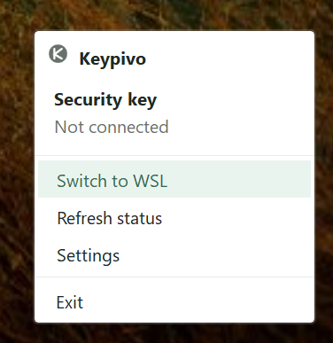

# Keypivo

A small Windows tray app for switching a security key between Windows and WSL2. Built with C# and WinForms. The interface and documentation are English-only.



## Requirements

- Windows 10 or 11.
- .NET 10 **Desktop Runtime**, or .NET 10 SDK for development.
- usbipd-win 5.x or a compatible version.
- An installed WSL2 distribution with an open terminal when connecting a key.

Install usbipd-win if needed:

```powershell
winget install --interactive --exact dorssel.usbipd-win
```

GnuPG, SSH agent, smart-card access, and Linux device permissions must be configured separately. Keypivo manages the USB connection.

## Run

Extract the entire `artifacts/keypivo-win.zip` package, then start `keypivo.exe`. Keep the adjacent DLL and JSON files with the executable. Keypivo's binary filenames are lowercase.

To open the popup immediately:

```powershell
.\artifacts\publish\keypivo.exe --show
```

Click or right-click the tray icon to open the compact menu:

1. **Security key** and its current status.
2. **Switch to WSL** or **Switch to Windows**, depending on the current connection.
3. **Refresh status**.
4. **Settings**.
5. **Exit**.

Click outside the popup or press Escape to dismiss it. The app keeps running in the tray. **Exit** stops the app and leaves the USB connection unchanged. A second instance is not started.

Device status is checked every two seconds and before each operation. After each switching command, the app waits for the resulting state to settle before reporting completion. State changes trigger Windows notifications, subject to the user's Windows notification settings. Error details appear only when requested through **View details**.

## Settings

Open **Settings** directly below **Refresh status**.

| Setting | Default | Behavior |
| --- | --- | --- |
| Vendor ID (VID) | `1050` | Required, exactly four hexadecimal digits. |
| Product ID (PID) | Empty | Optional, exactly four hexadecimal digits. Empty matches any PID under the selected VID. |
| Display position | Bottom right | Choose **Bottom right** or **Center**. Applies to the popup and Settings window on the primary display. |

The app positions windows within the display's working area, excluding the taskbar. Hexadecimal IDs are case-insensitive and saved in uppercase. Leading zeros are preserved.

**Save** persists the settings and immediately updates device selection. **Cancel** discards edits. Changing VID or PID does not attach, detach, or unshare any device. If a previously selected key is still attached, it remains attached until explicitly detached.

Settings are stored per Windows user in:

```text
%LOCALAPPDATA%\Keypivo\settings.json
```

When upgrading from an earlier release, existing settings are loaded automatically if no Keypivo settings file exists. Saving writes to the new location and leaves the previous file intact. An existing Keypivo settings file always takes precedence.

Example:

```json
{
  "VendorId": "1050",
  "ProductId": "",
  "Position": "BottomRight"
}
```

Invalid or unreadable settings fall back to the defaults and produce a notification. The original file is retained until the user saves settings. Writes use a temporary file and replacement to avoid leaving a partially written configuration.

## Device selection

- Only physically connected USB devices with valid bus IDs are eligible.
- VID and optional PID must match the USB hardware ID exactly. HID child interfaces and disconnected persisted registrations are excluded.
- If multiple devices match, the first entry in the `usbipd state` device array is selected. Other matching devices are not operated on.
- Each action reads the current state again. During verification, it follows that key's original instance ID and bus ID, even if enumeration order changes. A temporary disappearance is allowed; a different device cannot complete the operation or receive a follow-up command.
- Settings cannot change the filter while a USB operation is in progress.

## Sharing and switching

| Action | Commands | Elevation |
| --- | --- | --- |
| Switch to WSL | `bind --busid …` if not shared, then `attach --wsl --busid …` | UAC for `bind` only. |
| Switch to Windows | `detach --busid …` | Not required. |
| Stop sharing this key | `detach` if attached, then `unbind --busid …` | UAC for `unbind` only. |

Normal switching back to Windows preserves the persistent sharing registration. To remove that registration, use **Stop sharing this key** in Settings. This link is available only for a shared key and is disabled while there are unsaved changes.

The app itself runs without administrator privileges. It elevates only the sharing command that requires it.

The popup says **Connected** when usbipd reports a client attachment. The JSON state identifies an attached USB-IP client but cannot prove whether that client is WSL. Connections initiated by Keypivo always use WSL. **Available on Windows** means the device is not attached to a USB-IP client; it does not verify whether GPG or another application can access it.

### Waiting for a switch

USB devices can briefly disappear while Windows re-enumerates them, especially after detaching from WSL. After each command, Keypivo polls with a 500 ms pause between reads for up to 10 seconds, including time spent querying state. The same connected key must report the expected state consistently for at least one second before completion is confirmed. The popup stays on **Switching…**, controls remain disabled, and intermediate observations do not produce notifications.

If this deadline expires, the popup shows **Not confirmed · View details**, rather than reporting that the command failed. Regular status checks continue. If the original key later reaches a stable state matching the requested action, the warning clears automatically and a completion notification appears once. This recovery checks the final requested result: a delayed successful bind alone cannot confirm a switch to WSL. The app never retries USB commands automatically.

A new action or a VID/PID filter change abandons the previous pending confirmation. Actual command failures, including canceled administrator permission requests, remain separate errors and are not cleared by this automatic recovery.

## Build and test

The solution has no third-party NuGet package dependencies.

```powershell
dotnet build Keypivo.slnx -c Release -m:1
dotnet run --project tests/Keypivo.Tests -c Release --no-build
dotnet run --project src/Keypivo -c Release --no-build -- --show
```

The test runner covers device selection, switching, transient re-enumeration, stable-state confirmation, timeout recovery, command failures, concurrent operations, process timeouts, settings persistence and validation, filter changes, and window placement.

GitHub Actions runs these tests on Windows for every PR targeting `develop` or `main`. It also checks Store-publishing guards and builds a validated, self-contained x64 MSIX. Release setup, required Partner Center credentials, and the opt-in `main` publishing workflow are documented in [Store publishing](docs/store-publishing.md). Automatic Store submission is disabled until the initial Store publication and account setup are complete.

## Package

```powershell
.\scripts\publish.ps1
```

This builds, runs the tests, and creates `artifacts/publish` plus `artifacts/keypivo-win.zip`. Move an existing publish directory aside before running the script again.

For a package that includes the .NET runtime:

```powershell
.\scripts\publish.ps1 -SelfContained -Runtime win-x64
```

Use `win-arm64` for ARM64. The first self-contained build may need to download runtime packs. `-SkipTests` creates an explicitly unverified package when the environment prevents test execution.

The binaries are unsigned. PCs with application-control policies may require an approved signing or deployment process.

## Troubleshooting

- **Setup required:** install usbipd-win and refresh the status. Keypivo checks its standard Program Files location before searching absolute directories on PATH, so a PATH entry is not required for the standard installation.
- **No key detected:** check the connection and VID/PID settings. Leave PID empty to match all products under the selected VID.
- **Connection failed:** keep a WSL2 terminal open. Use **View details** for the command result.
- **Not confirmed:** the command returned, but the requested state did not stabilize within 10 seconds. Leave the key connected; status checks continue automatically. If it remains unconfirmed, inspect **View details** and the actual connection before retrying.
- **Administrator prompt canceled:** the operation stops and the actual state is read again. You can retry.
- **Sharing command failed:** elevated commands cannot redirect their output, so the app reports the exit code. Run the corresponding command from an administrator terminal to obtain further diagnostics.
- **Command timed out:** refresh before retrying. This differs from a state-confirmation timeout. An elevated child process may still be running if Windows prevented the app from terminating it.
- **Key is connected but GPG cannot use it:** check smart-card services and agent configuration on the selected operating system.

Verification results and the manual acceptance checklist are in [docs/verification.md](docs/verification.md).

## Project structure

- `src/Keypivo.Core`: hardware-ID matching, settings storage, placement calculations, process execution, and switching.
- `src/Keypivo`: compact menu, Settings dialog, tray icon, and notifications.
- `tests/Keypivo.Tests`: dependency-free console test runner.
- `scripts/publish.ps1`: build, test, and package script.
- `.github/workflows/ci.yml`: Windows CI and optional Store submission after a `main` merge.
- `packaging` and `scripts/package-store.ps1`: MSIX manifest and packaging.
- `docs/store-publishing.md`: first publication, API credentials, and release instructions.

## References

- [Microsoft: Connect USB devices to WSL](https://learn.microsoft.com/en-us/windows/wsl/connect-usb)
- [usbipd-win: WSL support](https://github.com/dorssel/usbipd-win/wiki/WSL-support)
- [usbipd-win: JSON automation](https://github.com/dorssel/usbipd-win/wiki/Automation)
